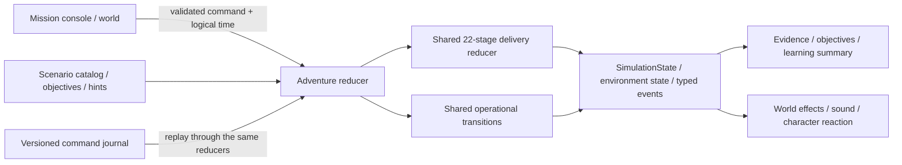

# Adventure orchestration

Phase 3 adds six local lessons around the existing infrastructure model. It does not introduce six private copies of deployment logic. Every lesson exposes a remote mission console and optional **Find facility** navigation; investigating requires an explicit inspection action, not merely opening a panel or walking into a trigger.

## Layers and contracts

- `src/adventures/domain.ts` defines serializable sessions, commands, evidence and decisions. Sessions have a selected adventure/variant, logical clock, shared `SimulationState`, completed objectives, captured evidence, bounded decision history, lifetime rejected-decision/hint counts and a status (`active`, `completed`, `cancelled`).
- `catalog.ts` owns the six definitions: difficulty, estimated learning time, goals, station bindings, selectable variants, objective explanations, four hint levels and concise/advanced completion content.
- `engine.ts` validates commands, captures actual evidence and enforces decision prerequisites. `createAdventure`, `reduceAdventure` and `tickAdventure` accept injected clocks. Invalid commands cannot corrupt state; wrong but recognized decisions produce educational feedback and remain recoverable.
- `selectors.ts` derives the current objective, action metadata, evidence, hint text and summary. These selectors cannot complete a mission or modify infrastructure.
- `src/simulation/engine.ts` still owns the existing delivery state machine. `promote-existing` reuses a proved development digest and resumes at the proposal stage; it does not build a second image.
- `src/simulation/operations.ts` owns operational seeding, controller timers and repairs for Pods, drift, incidents and recovery. Optional `EnvironmentState.operations` stores the actual configuration/evidence behind each fault. Pod readiness, replica counts, metrics, logs, routing and data health remain part of the same shared environment state used by inspectors and world effects.

The original free-exploration deployment lab remains available. Adventure actions route through the orchestration layer so a general lab button cannot bypass a lesson’s evidence or approval requirements.

## Six lessons

| Adventure | Required investigation and decision | Recovery and success condition |
| --- | --- | --- |
| Ship a New Release | Inspect a failing regression, repair it, inspect passing CI and the published digest, then approve | Shared lifecycle completes; explicit verification records mirror/sync, new healthy Pods, routing and telemetry |
| Recover a Failed Pod | Read status/events/resources; distinguish transient crash, invalid image, wrong readiness path or an unschedulable memory request | Choose the matching repair or observe the configured controller restart, then verify ready endpoints |
| Fix Configuration Drift | Compare reviewed Git replica count with live resources and inspect actual sync policy | Manual sync or explicitly configured self-heal converges live state, followed by verification |
| Promote to Production | Prove the development release and serving digest; review a separate production diff and approval | The exact same digest becomes healthy in production while development’s revision and digest remain unchanged |
| Investigate an Incident | Correlate the alert, Prometheus/Grafana metrics and timestamped Loki logs; choose among plausible diagnoses | Restore the reviewed connection-pool configuration, wait for new observations and verify the resolved alert and requests |
| Restore from Backup | Identify damaged records/object dependencies; compare consistency, age and storage location | Select a valid recovery point, restore database and objects separately, then validate before simulated traffic cutover |

The ship lesson intentionally begins with failed tests. **Retry unchanged CI** cannot repair it. **Repair regression and retry** is an explicit corrective action and still requires reinspection of the resulting checks. Approving stale or failed evidence leaves the gate closed.

Pod variants are technically distinct. The transient process exits once and the kubelet performs a modeled restart after eight logical seconds. The other causes remain broken indefinitely without correction. Image/probe repairs change explicit `imageReference` or `readinessPath` fields. Resource repair changes the declared request from 4096Mi to a measured 512Mi within 1024Mi available capacity. Readiness failure does not restart the container. These distinctions follow [Kubernetes Pod lifecycle](https://kubernetes.io/docs/concepts/workloads/pods/pod-lifecycle/), [probes](https://kubernetes.io/docs/concepts/configuration/liveness-readiness-startup-probes/) and [resource scheduling](https://kubernetes.io/docs/concepts/configuration/manage-resources-containers/).

The drift lesson offers both manual and explicitly enabled automatic self-healing. A live-only patch changes the visible replica count but leaves Git unchanged. Waiting with self-heal disabled does not reconcile anything. This models the distinction documented in [Argo CD automated sync policy](https://argo-cd.readthedocs.io/en/stable/user-guide/auto_sync/). The short lesson delays are illustrative, not claims about a production controller’s reconciliation interval.

Production promotion checks successful CI, the serving development digest and the published candidate before opening a separate proposal. Digests identify immutable content, as described in [Kubernetes image names and digests](https://kubernetes.io/docs/concepts/containers/images/). The model deliberately uses independent namespaces/configuration/secret references in a shared kind cluster, not physically separate production infrastructure.

The incident’s cause is one configuration change: pool capacity 8 → 1, followed by acquisition timeouts, HTTP 503s, 24% request errors and 900ms latency at stable 36 requests/s. The image is unchanged and logs show Traefik forwarded the request. A supported diagnosis and pool correction start a four-second logical observation window. New 200 responses, zero errors and 42ms latency then resolve the alert. These values form one deterministic teaching timeline; they are not random samples or real production metrics.

The restore lesson compares three points: a newest corrupt snapshot, a consistent but stale twenty-minute snapshot, and a verified two-minute snapshot within a five-minute RPO. Database and object recovery are separate operations because this application’s metadata references external object versions. The isolated target must pass consistency/count/reference checks before cutover. RTO is measured from detected loss to verified recovery and compared against five minutes; exceeding it remains visible rather than preventing valid recovery. All illustrated copies are on the same host, so the lesson explicitly explains their inability to survive host loss. The underlying distinction between backup techniques and their assumptions is documented in [PostgreSQL backup and restore](https://www.postgresql.org/docs/current/backup.html) and [SQL dumps](https://www.postgresql.org/docs/current/backup-dump.html).

## Evidence, objectives and hints

An inspection produces a named, timestamped snapshot of real modeled state. Approval matches the inspected digest and successful CI evidence against the current candidate; merely opening CI or registry UI is insufficient. Verification actions also check actual readiness, synchronization or data integrity. Completed objectives mean the relevant condition was demonstrated; wrong actions never increment mission progress.

Hints advance one level at a time: general guidance, relevant facility, specific evidence and a suggested correction. They can be disabled. Changing the current objective resets the visible level; lifetime hints used and rejected decisions remain available for result comparison even when bounded histories trim older entries. There is no arbitrary life loss or unrecoverable punishment.

## Clock, cancellation and replay

There is no `Date.now()`, randomness, animation callback or network request in the engine. Timed transitions emit their due timestamps even when the caller advances time in one large step. `eventSequence` increases with actual infrastructure events and explicit adventure actions, allowing persistence at safe boundaries without saving every render frame.

Cancellation preserves the stopped snapshot and is not an infrastructure rollback. Restart calls `createAdventure` with the selected ID/variant; completed records are separate immutable journal records. Replay reconstructs the same initial lesson and replays timestamped commands through the same reducer/tick functions. See the persistence documentation for record validation, migration and browser-storage recovery.

## Adding a lesson

1. Extend `AdventureId`, add catalog metadata and bind objectives/actions to existing station IDs.
2. Reuse the delivery reducer or add an application-independent operation in `simulation/operations.ts`. Keep configuration, observed symptoms and repair results in the shared infrastructure model.
3. Add explicit evidence prerequisites, guarded decisions and verification conditions in the adventure reducer. Keep presentation callbacks out of those rules.
4. Supply four ordered hints and a concise summary explaining the cause, decisions, technologies, reasoning and misconceptions.
5. Test success, plausible wrong actions, recovery, reset/cancel, environment boundaries and different tick cadences. Add the visible browser journey before claiming the lesson complete.

`node --import tsx --test tests/adventures.test.ts tests/simulation.test.ts` checks the pure lesson and underlying delivery contracts. Browser and persistence/replay tests exercise these same reducers rather than a parallel scripted demo implementation.
