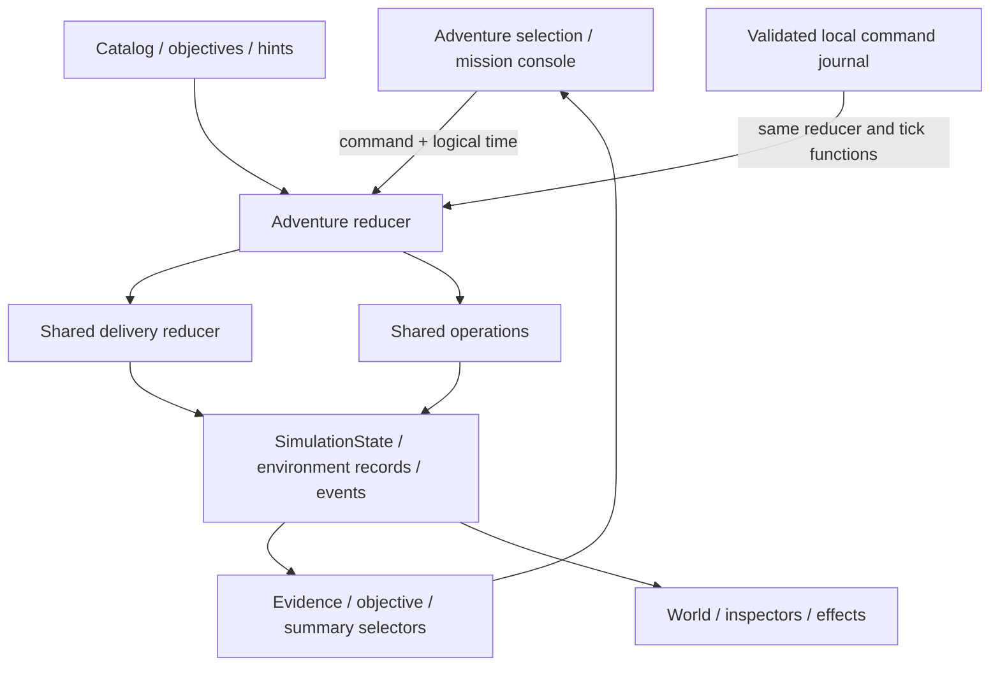

# World and runtime architecture

The Vite/React/R3F application runs locally with no backend. Phase 1 established the character and explorable districts; Phase 2 added the shared deployment model and technology registry; Phase 3 adds six interactive adventures, a local notebook, deterministic replay and the engineering showcase. `App.tsx` composes screen routing, settings, discovery panels and the adventure controller. `Scene.tsx` owns the live Three.js graph. Pure TypeScript modules contain navigation, camera, behavior and simulation rules so they can be tested without a GPU. The 3D scene is lazy-loaded separately from the interface.

## Shared world data

`src/data/world-layout.json` is consumed by both Blender Python and TypeScript. It defines the hub, six districts, 17 stations and 12 sampled curved bridges. World coordinates are Y-up in meters; the generator converts them to Blender Z-up. A district export is local to its center and is placed there exactly once by R3F. The hub export includes the bridges in global coordinates.

| District | Identity | Discoveries |
| --- | --- | --- |
| Development & CI / Maker Village | Workshop roofs and automated factory | GitHub, CI, delivery |
| Images & Infrastructure / Container Harbor | Warehouse, crane, containers | Registry, infrastructure, containers |
| Kubernetes & GitOps / Cluster City | Server towers and network equipment | Kubernetes, GitOps, networking |
| Security & Secrets / Cipher Keep | Vault, checkpoint and fortress | Security, secrets, supply chain |
| Observability / Signal Heights | Observatory and signal tower | Observability, alerts |
| Data & Recovery / Memory Gardens | Database, messaging, recovery facilities | Database, messaging, recovery |

Each district connects to the Common and its two neighbors. Elevations vary from 0.2 to 0.85m. The layout reserves open interiors and uses two large landmarks plus an optional smaller related stop per district. The generated terrain has deeper faceted undersides, vegetation, arrival banners and shared materials. Six runtime beacon instances gently pulse at entrances; reduced motion freezes them.

## Interaction and personality

`eligibleStation()` uses horizontal distance, elevation and hysteresis. A ring highlights the eligible station and the HUD names it. E or the touch prompt opens a shared `Dialog`; a 650ms guard, key-repeat suppression and modal input blocking prevent accidental reopening. The current station panel presents registry-driven technology tabs, responsibilities, inputs/outputs, related technologies, advanced source links and a snapshot of the selected environment. It retains the discovery badge. The shared layout's `future` field is legacy metadata and is not displayed or used to gate playable adventures.

Free exploration retains the Deployment Lab and its basic simulated backup/restore controls. During an adventure, inspectors read that adventure's infrastructure state and lab mutation buttons are disabled; the panel links back to the mission console. The mission console provides explicit inspection, decision and verification actions with optional **Find facility** navigation. Opening a station or reaching its marker does not itself record evidence or advance an objective. All services remain simulated locally.

`progress.ts` validates versioned discovery storage, drops unknown IDs, deduplicates discoveries, and counts the six district introductions. Entering a district and discovering a station are separate events. Local storage failure leaves the session usable and shows a notice. Recovery resets position and camera but preserves discoveries. The settings action **Reset exploration progress** is separate from resetting the adventure notebook. Finishing six introductions triggers a celebration after the panel closes.

`behavior.ts` selects Curious near stations, Thinking while reading, Happy after an interaction, Worried after pushing a boundary, Determined while recovering, Excited while running and Sleepy after 22 seconds of inactivity. These facial cues do not seize movement controls. A movement command can interrupt a gesture. Explicit short reactions expire after 2.2 seconds.

Adventure selectors add reactions tied to evidence and infrastructure events, including curiosity during inspection, thought after a wrong choice, determination during recovery and celebration on verified completion. Original Web Audio oscillator cues provide optional local feedback for movement, interaction, builds, warnings and outcomes. Sound starts muted, unlocks after a user gesture, and has volume and bounded voice/cooldown controls. See [EFFECTS.md](EFFECTS.md) for event projection and resource ownership.

The animation mixer drives the five authored skeletal clips. The cached morph controller runs afterwards and changes only facial influences. World motion always uses normal animation playback speed; the studio speed control is isolated from gameplay. Position and camera refs update every rendered frame; UI telemetry is published at most five times per second.

## Rendering and ownership

GLBs are loaded through the shared `useGLTF` cache. Static district meshes keep normal frustum culling. The one animated hero disables rest-bound culling because its crown and face deform beyond static bounds. Skeleton cloning isolates the character's pose; cached geometry and materials remain shared. `useAnimations` cleans up its mixer and the explicit finished listener is removed on cleanup. DOM input handlers, timeouts and dialog focus are also cleaned up.

Six entrance beacons use one `InstancedMesh`. World meshes are joined by material during generation; reusable building prototypes and a shared material library avoid duplicated authoring. Shadows cover a 24m region centered on the player. Low quality disables shadows, while all modes limit pixel ratio. No full-world triangle collision queries occur in the frame loop.

## Add a future location

1. Add a station record to the shared JSON with a stable ID, district, local concept content, world position, radius and model key. Keep its collider outside bridge entrances and other stations.
2. Add or reuse a factory function in `scripts/blender/asset_factory.py`; fit visible geometry within the declared footprint. Keep signs overhead or outside walkable space.
3. Regenerate the environment and inspect the district close render and runtime camera view. Run navigation reachability, bounds/winding and GLB checks.
4. No UI switch statement is needed: minimap, proximity, discovery panel and progress consume station data. Old saves accept new IDs automatically when they are discovered.
5. Extend the typed domain and add deterministic tests for a new simulation capability. Derive educational graph links and station inspection from the shared technology registry.

## Shared infrastructure layer, introduced in Phase 2

`src/simulation/domain.ts` defines serializable events, commands and environment state. `engine.ts` is a deterministic reducer with an injectable clock; `scenario.ts` declares the 22-stage guided deployment. `registry.ts` owns 43 technology explanations and 49 graph relationships mapped to the existing facilities. The 2D architecture explorer and 3D station panels use that same registry. `components/useSimulation.ts` advances the free-exploration lab on a 100ms timer independently of WebGL frames. Phase 3's `operations.ts` centralizes additional operational faults and repairs on this same state model, including Pod recovery, configuration drift, incidents and data recovery.

`App.tsx` supplies the active adventure or replay's `SimulationState` to the world and inspectors; outside a mission it supplies the separate lab instance. These are independent sessions using one infrastructure implementation. `SimulationEffects.tsx` only projects the selected state and its history into visuals. No visual completion can approve a pull request or advance a stage. See [SIMULATION.md](SIMULATION.md) and [INFRASTRUCTURE.md](INFRASTRUCTURE.md) for dependency and environment contracts.

## Phase 3 adventure orchestration

`src/adventures/catalog.ts` defines **Ship a New Release**, **Recover a Failed Pod**, **Fix Configuration Drift**, **Promote to Production**, **Investigate an Incident** and **Restore from Backup**. Its declarative metadata supplies difficulty, learning goals, station bindings, objectives, four hint levels and completion explanations. Pod recovery has four distinct causes; drift has manual and self-heal policies. No extra world-layout records or facilities are required.

`engine.ts` creates a serializable `AdventureSession`, validates commands, captures timestamped evidence from shared state and checks prerequisites for decisions. Explicit inspections and verification are required; recognized wrong choices remain recoverable and explain their consequences. `selectors.ts` derives actions, objectives, revealed hints, companion reactions and causal completion summaries. All infrastructure changes go through delivery or operational transitions, not UI callbacks. Production promotion reuses the exact verified development digest through a second approval gate rather than rebuilding it.

`useAdventures.ts` drives logical time independently of rendering and owns launch, pause, resume, cancel, restart and replay controls. Opening the adventure chooser or leaving the adventure pauses work; the mission console itself can stay open while automation proceeds. Paused/replay controls reject infrastructure actions. Completed summaries retain observed causes, decisions, technologies, why the correction worked and common misconceptions. [ADVENTURES.md](ADVENTURES.md) documents the lesson contracts and extension workflow.

## Local notebook and replay

Discovery and visual preferences keep their original storage contracts. The separate version 2 adventure notebook stores the selected lesson, active and suspended attempts, best completed recordings and hint preference. Each recording contains the scenario/variant, initial hint setting, elapsed logical time and timestamped user commands. Evidence, objectives and infrastructure snapshots are reconstructed through the same reducers; saved claims of completion are verified, not trusted.

The notebook is bounded at 512 Ki JSON characters, 512 commands per attempt and fourteen days of logical time. It saves on explicit actions and infrastructure event boundaries, plus pause/pagehide/visibility checkpoints. Hidden and reloaded sessions remain paused without offline catch-up. Supported version 1 records migrate explicitly; malformed or unsupported saves retain the original bytes, block automatic overwrite and offer export/recovery. Storage failures keep the in-memory session usable and show recovery controls.

Replay clones a completed recording and reconstructs a separate session at the playhead. Pause, resume, restart and 0.5×/1×/2×/4× playback never mutate the live attempt or its completed records. Exiting replay returns to the paused live session. Best results compare lifetime rejected decisions, then hints used; elapsed speed is not scored. See [PERSISTENCE.md](PERSISTENCE.md) for validation, migration and recovery details. The portfolio showcase presents these authoring, simulation and rendering layers from the same local application.
